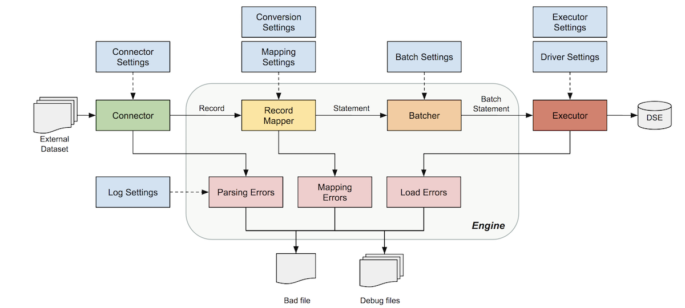
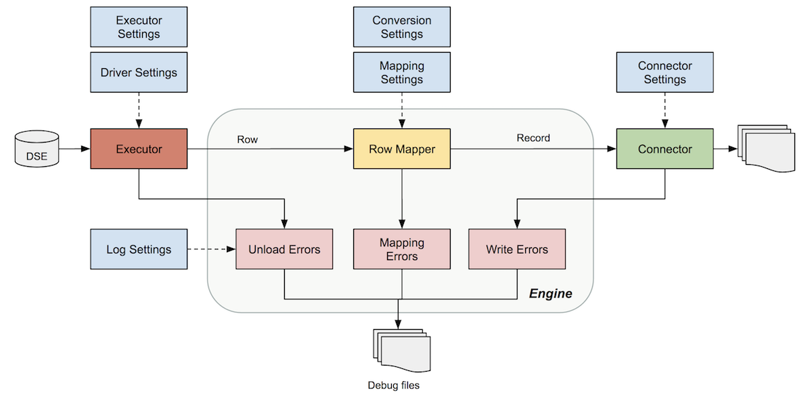

# DSBulk synopsis and usage

DataStax Bulk Loader provides the `dsbulk` command and the subcommands `load`, `unload`, `count`, and `help`.

For example, the following command loads data from a CSV file into a table in a self-managed cluster, such as DataStax Enterprise (DSE), that requires authentication with a username and password:

```bash
dsbulk load \
  -u username -p password -h '10.200.1.3, 10.200.1.4' -port 9876 \
  -k ks1 -t table1 \
  -url filename.csv
```

`dsbulk` is launched from the `bin` directory of your DSBulk installation.
If your machine cannot automatically detect the path to the `dsbulk` executable, you might need to provide the path on the command line.
For more information, see [Post-install requirements and recommendations](01-install.md#dsbulkPostInstallRequirementsAndRecommendations).

> [!TIP]
> To test a `dsbulk load` operation without writing the data to your database, use the [`--dryRun`](options/engine-options.md#engine-dryRun) option.

## Synopsis

```bash
dsbulk SUBCOMMAND OPTIONS
```

Replace **`SUBCOMMAND`** with the operation to perform:

- [`load`](dsbulk-load.md)
- [`unload`](dsbulk-unload.md)
- [`count`](dsbulk-count.md)
- [`help`](#get-help)

Replace **`OPTIONS`** with any of the DSBulk options, including general options and subcommand-specific options.
Many options have defined or inferred default values.
Some options are required depending on the subcommand and cluster configuration:

- **Connection and authentication options**: Clusters with authentication enabled require [driver authentication and connection options](options/driver-options.md).
  A [configuration file](#use-a-configuration-file) is recommended for sensitive values, such as passwords.
- **Schema options**: `load`, `unload`, and `count` subcommands always require that you specify the target schema for the operation.
  There are multiple ways to specify the schema.
  For all options, see [Schema options](options/schema-options.md).
  - **Target by keyspace and table name**: To target a keyspace and table by name, use the `-k` (`--schema.keyspace`) and `-t` (`--schema.table`) options.
    This is best when you want to target the entire table, such as when loading data.
  - **Target by CQL statement**: To select data using a Cassandra Query Language (CQL) statement, use the `-query` (`--schema.query`) option.
    This is best when you want to target a subset of the data in a table, such as when unloading or counting data.

    If you specify `-k` and `-query`, you can omit the keyspace name from the CQL statement in `-query`.

  - **Target graph data**: The `-g` (`--schema.graph`), `-v` (`--schema.vertex`), and `-e` (`--schema.edge`) options can be used to target graph data.
- **Data source or destination**: For the `load` and `unload` subcommands, you must specify a data source or destination.
  When loading, this is the source of the data you want to load into the table.
  When unloading, this is the destination where you want to write the unloaded data.

  For options and examples, see the following:
  - [CSV and JSON connector options](options/connector-options.md)
  - [Load data](dsbulk-load.md)
  - [Unload data](dsbulk-unload.md)

## <a id="get-help"></a>Get help

Get help and information about `dsbulk` and its options:

```bash
dsbulk help
```

Get help with a specific option:

```bash
dsbulk help connector.csv
```

Get short form options and help:

```bash
dsbulk -c csv --help
```

## <a id="version"></a>Get the version

Get your current version of DSBulk:

```bash
dsbulk --version
```

## <a id="escape-and-quote-command-line-arguments"></a>Escape and quote command line arguments

When supplied on the command line, all option values must be in valid HOCON syntax:

- Control characters, backslashes, and double-quotes must be properly escaped.

  For example, use `\t` to escape the tab character, and use `\\` to escape the the backslash character:

  ```shell
  dsbulk load -delim '\t' -url 'C:\\Users\\My Folder'
  ```

- Strings containing special characters must be double-quoted.

  For example, if your file path contains spaces, you must quote the entire string, and escape the backslashes in the path:

  ```shell
  dsbulk load -url "C:\\Users\\My Folder\\filename.csv"
  ```

  > [!IMPORTANT]
  > The following [schema options](options/schema-options.md) accept string-like values that must not be quoted:
  > `--schema.keyspace`, `--schema.table`, `--schema.graph`, `--schema.vertex`, `--schema.edge`, `--schema.from`, and `--schema.to`.

- When passing CQL statements in the [`-query`](options/schema-options.md#dsbulkSchemaQuery) option, double-quotes must be escaped.

  For example, if your CQL statement contains a mixed-case table name, you must quote and escape the table name:

  ```bash
  dsbulk unload -query
    "SELECT id, row1, row2
      FROM ks1.\\\"tableMixedCase\\\"
      WHERE row1='some-value'"
  ```

## Syntactic sugar for string, list, and map arguments

> [!IMPORTANT]
> The following syntactic sugar is available for string, list, and map arguments passed directly on the command line _only_.
> All other types, and all options specified in configuration files, must be fully compliant with HOCON syntax.
> You must ensure that these values are properly escaped and quoted.

On the command line, when an argument expects a string, you can omit the surrounding double-quotes for convenience.
For example, the following two lines are equivalent:

```shell
dsbulk load -url '"C:\\Users\\My Folder"'
dsbulk load -url 'C:\\Users\\My Folder'
```

On the command line, when an argument is a list, you can omit the surrounding square brackets.
The following two lines are equivalent:

```bash
dsbulk load --codec.nullStrings 'NIL, NULL'
dsbulk load --codec.nullStrings '[NIL, NULL]'
```

On the command line, when an argument is a map, you can omit the surrounding curly braces.
The following two lines are equivalent:

```bash
dsbulk load --connector.json.deserializationFeatures '{ USE_BIG_DECIMAL_FOR_FLOATS : true }'
dsbulk load --connector.json.deserializationFeatures 'USE_BIG_DECIMAL_FOR_FLOATS : true'
```

## Exit codes

The `dsbulk` command can return the following exit codes to indicate the status of an operation:

- `0`: `STATUS_OK`
- `1`: `STATUS_COMPLETED_WITH_ERRORS`
- `2`: `STATUS_ABORTED_TOO_MANY_ERRORS`
- `3`: `STATUS_ABORTED_FATAL_ERROR`
- `4`: `STATUS_INTERRUPTED`
- `5`: `STATUS_CRASHED`

## <a id="use-a-configuration-file"></a>Use a configuration file

You can pass all DSBulk options as command line arguments or in configuration files.
Using one or more configuration files is often easier than passing all configuration options on the command line.

> [!IMPORTANT]
> Options set on the command line override options set in configuration files.

### Configuration file location

By default, configuration values are loaded from the `conf` directory of your `dsbulk` installation.
This directory includes empty `application.conf` and `driver.conf` files that you can customize for your environment.
`application.conf` is the main configuration file for DSBulk options.
It includes a reference to `driver.conf`, which is used to configure the [Java driver options](options/driver-options.md).
For commented example files, see [`application.template.conf`](https://github.com/datastax/dsbulk/blob/1.x/manual/application.template.conf) and [`driver.template.conf`](https://github.com/datastax/dsbulk/blob/1.x/manual/driver.template.conf).

To load a custom configuration file from a non-default location, use the `-f` option to specify the path to the file on the command line.
For example:

```bash
dsbulk count -f /path/to/custom_config.conf
```

### Long form for option names

When setting options in configuration files, you must use the long form for the option names, which includes a prefix.

For most options the prefix is `dsbulk.`, such as `dsbulk.connector.csv.recursive = true`.

For the [driver options](options/driver-options.md), the prefix is `datastax-java-driver`, such as `datastax-java-driver.basic.request.consistency = "QUORUM"`.

Configuration files won't work with short forms or standard forms without the proper prefix.

### HOCON syntax

The structure and contents of DSBulk configuration files must comply with HOCON syntax.
This syntax is flexible, and it allows sections to be grouped together with blocks, dot notation, or both.
For example, with nested block notation:

```json
dsbulk {
  connector {
    name = "csv"
      csv {
        url = "C:\\Users\\My Folder"
        delimiter = "\t"
      }
   }
 }
```

Or dot notation:

```json
dsbulk.connector.name = "csv"
dsbulk.connector.csv.url = "C:\\Users\\My Folder"
dsbulk.connector.csv.delimiter = "\t"
```

Or combined block and dot notation:

```json
dsbulk {
   connector.name = "csv"
   connector.csv.delimiter = "|"
   schema.keyspace = "myKeyspace"
   schema.table = "myTable"
   schema.mapping = "0=name, 1=age, 2=email"
}
```

For information about HOCON syntax for configuration values, see [Escape and quote command line arguments](#escape-and-quote-command-line-arguments).

### Use file inclusions for multiple configuration files

If you split your configuration across multiple files, then you must use HOCON-formatted file inclusions in the primary configuration file.
For example:

```json
include classpath("other-conf-file.conf")
```

## <a id="prompt-for-passwords"></a>Prompt for passwords

You can use the `--runner.promptForPasswords` (`--dsbulk.runner.promptForPasswords`) option to control whether DSBulk prompts for passwords that are missing from configuration files:

- **`true` (default)**: If a username is present in the configuration, but the corresponding password is missing, DSBulk prompts the user to enter the password on the command line.

  Prompting for passwords requires an interactive shell.
  If the standard input isn't connected to a terminal, DSBulk doesn't prompt for passwords, even if this option is enabled.

  Because DSBulk bypasses password prompting when it's impossible, only disable this option if DSBulk assumes incorrectly that it is running in an interactive shell.

- **`false`**: DSBulk never prompts for missing passwords.

## DSBulk options

The DSBulk engine is the key architectural component responsible for the orchestration of DSBulk operations.
The main features provide options that can be set on the command line or in configuration files.

- **[Core configuration](options/engine-options.md)**: The engine collects user-supplied settings, merges them with default values and configures the loading/unloading operation to run.

- **Connection handling**: The engine handles the [Apache Cassandra® Java driver connection](options/driver-options.md) to your database, and the [connectors that read and write CSV and JSON data](options/connector-options.md).

  The engine manages the driver-specific settings, and it supports authentication and SSL encryption.

  For execution of `load` batches, use the dedicated [batch options](options/batch-options.md).

- **[Conversion](options/codec-options.md)**: The engine handles data type conversions such as Boolean, number, or date conversions to appropriate internal representations.

  The internal representation is typically a Java Temporal or Number object.
  The external representation can be anything, and it is typically strings or raw bytes as emitted by a [connector](options/connector-options.md).

  DSBulk also handles `NULL` and `UNSET` values, with options for multiple representations of `NULL` and `EMPTY` values.

- **[Mapping](options/schema-options.md)**: The engine can analyze metadata gathered from the driver, and then infer the appropriate `INSERT` or `SELECT` prepared statement. It then checks this information against user-supplied information about the data source to infer the bound variables to use. Alternatively, you can provide your own explicit mapping.

- **[Monitoring](options/monitor-options.md)**: The engine reports metrics about all its internal components, mainly the connector and the bulk executor.

- **[Error handling](options/logging-options.md)**: The engine handles errors from both connectors and the bulk executor. It reports read, parse, and write failures.

The following diagrams show where certain options are incorporated in the DSBulk workflow.

### DSBulk loading workflow diagram



### DSBulk unloading workflow diagram


